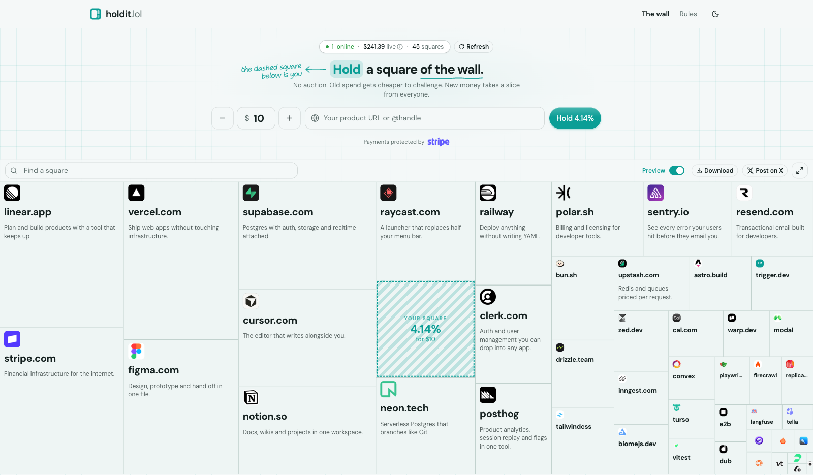

# holdit.lol

**A wall of everyone paying for attention, sized by live spend.**

<picture>
  <source media="(prefers-color-scheme: dark)" srcset="docs/screenshot-dark.png">
  
</picture>

Your share follows your live spend against everyone else's. New spend takes a
slice sized to what they paid. Displayed spend is half every 14 days — one rate
for every dollar. Extra spend past the cap does not fade slower; it holds the
cap as others buy.

No auction. Nobody outbid. Nobody pushed off. From $1.

## Stack

| Concern | Choice |
|---|---|
| App | [Next.js](https://nextjs.org) 16, React 19, TypeScript |
| Styling | Tailwind CSS v4 |
| Database | Postgres 17, [Drizzle](https://orm.drizzle.team) |
| Payments | [Stripe](https://stripe.com) Checkout |
| Rate limiting | [Upstash](https://upstash.com) Redis, skipped when unset |
| Lint / format | [Biome](https://biomejs.dev) |
| Tests | [Vitest](https://vitest.dev) |

## Running it

```bash
pnpm install
pnpm db:local                 # Postgres on :55432
cp .env.example .env.local
pnpm db:migrate && pnpm db:seed   # first run, or after wiping the volume
pnpm dev                      # http://localhost:3001
```

Use `.env.local` for local development. It is gitignored. Next.js reads it, and
`drizzle.config.ts` loads it because drizzle-kit runs outside Next. Production
sets the same variables on the host. Do not commit them.

`db:seed` applies [`scripts/seed.sql`](./scripts/seed.sql) to the running
container: the founding wall is development data, so it is SQL mounted by
[`docker-compose.yaml`](./docker-compose.yaml) rather than TypeScript the app
could import. It puts the founding squares up, and the buy → map-resize loop
works end to end from there. The database is required: there is no in-memory
fallback, because a deployment
that lost its `DATABASE_URL` would otherwise present a demo wall as a real one
— a failure that looks exactly like success.

Postgres data lives in a Docker volume, so `pnpm db:local` followed by `pnpm
dev` is enough on later sessions. `pnpm db:migrate && pnpm db:seed` is only
needed on a fresh volume (first checkout, or after `docker compose down -v`).

```bash
pnpm test              # unit tests; no database
pnpm test:integration  # needs the container: five suites against real Postgres
pnpm typecheck
pnpm lint              # biome; `pnpm lint:fix` writes fixes
pnpm build             # prerenders the wall, so it needs the database too
```

`pnpm test:integration` points itself at the database from
`docker-compose.yaml` and truncates between tests, ignoring `DATABASE_URL` so
a real one can never be emptied. Override with `TEST_DATABASE_URL` if you need
somewhere else.

## Contributing

See [CONTRIBUTING.md](./CONTRIBUTING.md). By participating you agree to the
[Code of Conduct](./CODE_OF_CONDUCT.md). Security reports go to the address in
[SECURITY.md](./SECURITY.md), not to a public issue.

## License

[MIT](./LICENSE) © [Alexandre Marques](https://twitter.com/alexlmarques)
